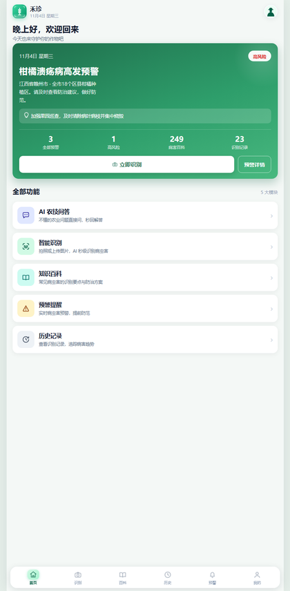
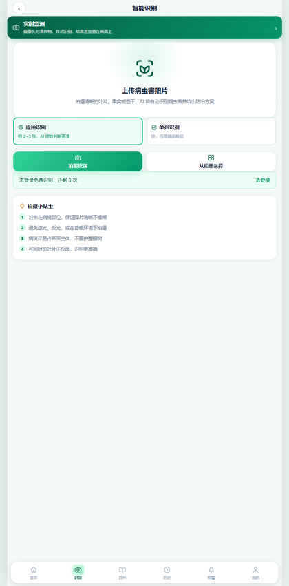
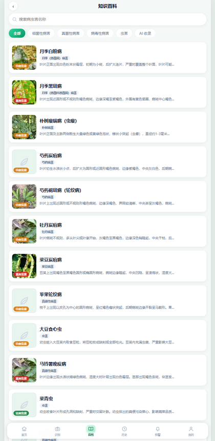
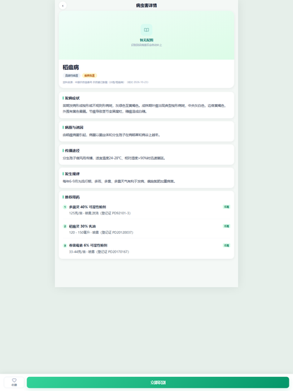
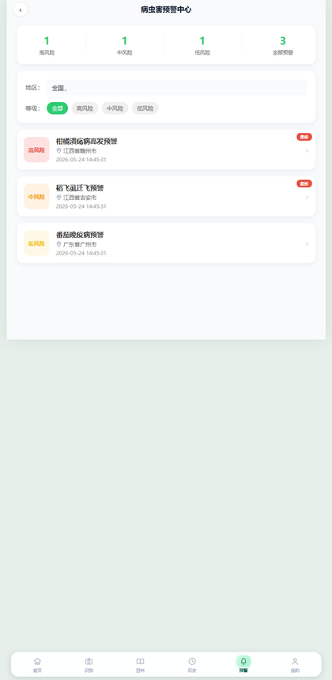
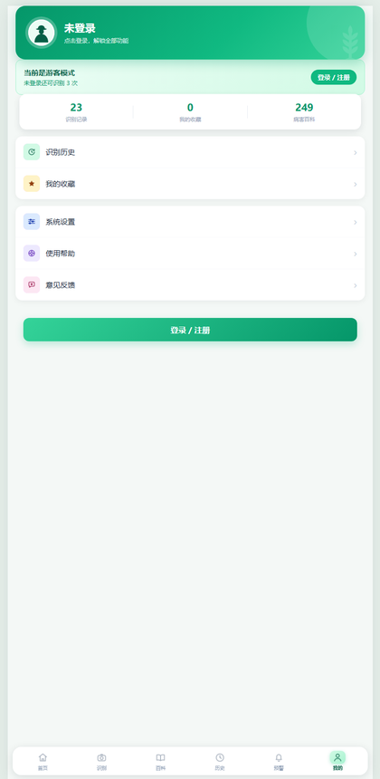
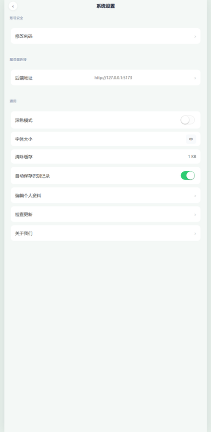
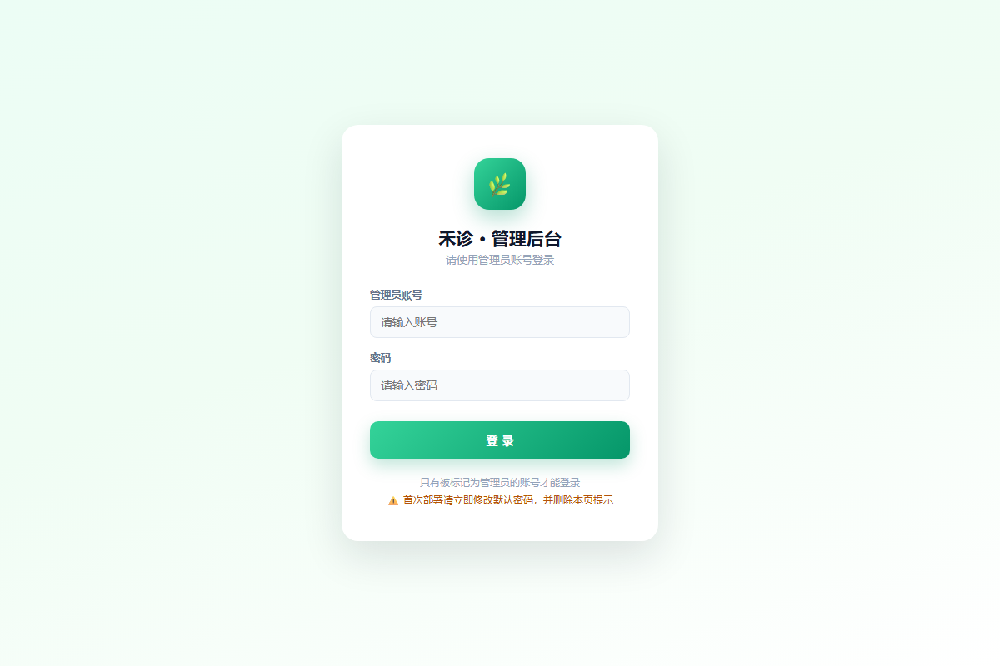

# 禾诊 · 操作手册

> 面向使用者的说明书　｜　版本 v1.0　｜　2026-11-05
> 适用：网页版（H5）· 微信小程序 · Android App

---

## 一、三种使用方式

同一个项目，可以三种方式用，功能基本一致：

| 方式 | 适合谁 | 怎么得到 |
|---|---|---|
| **网页版** | 有电脑、想快速试 | 电脑上跑起来，浏览器打开 |
| **微信小程序** | 手机日常使用 | 微信开发者工具导入（仓库已带编译好的包）|
| **Android App** | 不想依赖微信 | 下载 APK 安装（仓库已带安装包）|

> 三者都需要连接同一个「后端服务」——识别、百科、登录都靠它。
> 后端可以跑在你自己的电脑上，也可以部署到服务器。

---

## 二、三分钟上手（电脑）

### 第 1 步：装 Node.js

打开 https://nodejs.org/zh-cn ，下载 **LTS 版本**（推荐 22.x），一路下一步。
安装时**勾选 Add to PATH**。

装完验证（可选）：打开 PowerShell 输入 `node -v`，能显示版本号即可。

### 第 2 步：启动

把项目文件夹放到任意位置，双击根目录的：

```
一键启动.bat
```

它会自动完成：

```
检查 Node 版本 → 检查依赖（缺了自动装）→ 启动后端
→ 健康检查 → 启动前端 → 打开浏览器
```

第一次会慢一点（要装依赖，约 15~60 秒）。

### 第 3 步：打开页面

看到这样的输出就成功了：

```
后端已启动: http://localhost:3000
管理后台:   http://localhost:3000/admin
H5 已启动:  http://localhost:5173
```

浏览器会自动打开。没打开就手动访问 **http://localhost:5173**



---

## 三、网页版怎么用

### 1. 拍照识别

底部导航点 **「识别」** → 拍照或从相册选 → 等 3~6 秒 → 出结果。



结果里有：

- 病害名称 + 置信度
- 危害等级
- 症状、传播途径、发生规律
- **用药方案**（药名 + 稀释倍数，来自官方农药登记库）
- 防治建议、预防措施

> 没配 AI 密钥时会明确提示「未配置 AI 密钥，无法识别」，不会返回假结果。

### 2. 查知识百科

底部 **「百科」** → 搜索或按分类筛选 → 点条目看详情。




### 3. 看预警

底部 **「预警」** → 上半部分是**本地风险预测**，下半部分是管理员发布的预警。



**本地风险预测怎么来的**

1. 顶部「地区」选你的省份（江西省 / 广东省 / 湖南省 / 福建省 / 浙江省）
2. 系统自动取当地未来 3 天天气（温度 / 湿度 / 降雨）
3. 和知识库里每种病的发病条件对照，算出风险

卡片里这样看：

| 显示 | 含义 |
|---|---|
| 今天 / 11-06 / 11-07 | 未来三天 |
| 17℃ · 湿度 92% · 雨 45.4mm | 当天的天气 |
| 红色「番茄晚疫病 高风险」| 条件全部吻合，要提前防 |
| 黄色「中风险」| 条件部分吻合，留意 |
| 绿色「低风险」| 勉强擦边，可以先不管 |

> 高风险不代表一定发病，只是「天气条件已经具备」。
> 具体要不要打药，还得看地里实际情况——卡片底部那行小字说的就是这个。

选「全国」时不会显示预测，因为算哪个城市的天气都不合适。

### 3.5 分享给朋友

**网页版**：打开某个病害详情页 → 底部点 **「分享」** → 链接自动复制 → 粘到微信发出去。

**微信小程序**：详情页右上角 **「···」→ 转发**，会生成一张带病害图的卡片。

**App**：点「分享」会复制下载地址（方便发给别人装）。

> 分享出去的链接点开就是这一条病害的详情，不用登录也能看。

### 4. 识别历史 / 收藏 / AI 问答

- 底部 **「历史」**：看自己识别过的记录（登录后才有）
- 百科详情页点 **收藏**：存到「我的 → 我的收藏」
- 首页 **AI 农技问答**：直接打字问「玉米叶子发黄怎么办」

### 5. 我的



查看统计、收藏、设置、帮助。

---

## 四、Android App 怎么用

### 1. 下载安装

打开仓库：**https://github.com/yinlang1314/hezhen**

```
进入仓库 dist/apk/ → 点 hezhen-v1.0.1.apk → 右上角 Download
把文件传到手机 → 点安装 → 允许「未知来源」
```

> 安装包 15 MB，包名 `com.yinlang1314.hezhen`，版本 1.0.0。

### 2. 设置服务器地址（关键）

App 里默认写着一个 IP，**换了网络就连不上**。第一次装好请先改：

```
我的 → 设置 → 服务器连接 → 后端地址
填：http://<后端电脑的局域网IP>:3000
点「保存并测试」
```



**怎么查后端电脑的 IP**：后端启动时控制台会打印，例如

```
🌐 可用后端地址：
   http://192.168.5.14:3000
```

手机和电脑**必须连同一个 Wi-Fi**。

### 3. 使用

> **升级**：设置 → 检查更新 → 有新版本会提示，点「去下载」用浏览器装新版（覆盖安装，数据不丢）。

和网页版一样：识别、百科、历史、预警、问答。

---

## 五、微信小程序怎么用

### 1. 装开发者工具

下载「微信开发者工具」（稳定版）：
https://developers.weixin.qq.com/miniprogram/dev/devtools/download.html

### 2. 导入项目

```
打开工具 → 导入项目 → 目录选仓库里的 dist/mp-weixin
AppID：填你自己的（或先用测试号）→ 确定
```

### 3. 关掉域名校验（开发阶段必须）

```
右上角「详情」→「本地设置」→ 勾选「不校验合法域名、web-view（业务域名）、TLS 版本以及 HTTPS 证书」
```

> 正式发布的小程序必须用 HTTPS 域名，开发阶段可以跳过。

### 4. 设置后端地址

两种办法，任选：

**办法 A（不用重新编译）**

```
调试器 → Storage 面板 → 点「+」
键名：backendUrl
类型：string
值：  http://<后端电脑IP>:3000
然后点工具栏「编译」
```

**办法 B（改代码）**

改 `utils/config.js` 里的 `BACKEND_HOST` → HBuilderX 重新编译 → 重新导入。

### 5. 在手机上预览

点工具栏 **「预览」** → 出二维码 → **手机微信扫码** → 打开小程序。

> 手机也要连同一个 Wi-Fi，且后端地址填的是电脑局域网 IP。

### 6. 正式发布要什么

| 条件 | 说明 |
|---|---|
| 自己的小程序 AppID | 微信公众平台注册（个人可注册）|
| HTTPS 域名 | 小程序强制要求，且域名要备案 |
| 提交审核 | 审核通过后才能在微信里搜到 |

---

## 六、修改服务器地址的三种方式

| 场景 | 方法 | 要不要重新编译 |
|---|---|---|
| App / 小程序装在别人手机上 | App 内「设置 → 服务器连接」/ 小程序 Storage 的 `backendUrl` | 不用 |
| 开发者本地调试 | 同上 | 不用 |
| 要固定一个地址发给别人 | 改 `utils/config.js` 的 `BACKEND_HOST` | 要 |

**地址格式**：`http://IP:3000`（本地）或 `https://你的域名`（线上）。
结尾不要加斜杠，脚本会自动处理。

---

## 七、管理员：后台怎么用

### 1. 登录

```
http://localhost:3000/admin
账号：admin
初始密码：123456（可用 .env 里的 ADMIN_INIT_PASSWORD 指定，登录后请立即改）
```



### 2. 病虫害库管理

```
病虫害库 → 看到 249 条数据，每条标注「已核实 / 待核实」
```

- **核实**：点「核实」→ 必须填**数据来源**和核对日期 → 这条才会出现在 App 里
- **批量核实**：切到「待核实」页签 → 勾选多条 → 点「批量核实选中的」→ 没来源的会自动跳过并告诉你跳了几条

> ⚠️ 批量核实省的是点按次数，不是审核工作。**来源只证明名录里有这个病，症状和用药是 AI 写的**，
> 上线前请自己扫一眼内容。
- **补图**：点「补图」上传照片 → 详情页立刻有图
- **编辑**：改症状、用药、防治
- **隐藏**：临时下架

> 原则：**没来源不上线**。AI 生成的内容带「（AI草稿）」标记，核实时自动去掉。

### 3. 其他页面

| 页面 | 作用 |
|---|---|
| 数据概览 | 访问量、识别数、用户数 |
| 用户管理 | 查看用户、重置密码 |
| 识别历史 | 全部用户的识别记录 |
| 用户纠错 | 用户提交的纠错 → 见下方「4. 用户纠错怎么复核」|
| 意见反馈 | 用户留言 |
| 安全与日志 | 登录记录、异常 IP |

### 4. 用户纠错怎么复核（重点）

用户在 App 里点「结果不对」提交纠错后，会进入**待复核**队列，不会直接上线。

```
后台 → 用户纠错 → 待复核（页签上显示条数）
```

**每条记录看三样**

| 列 | 含义 |
|---|---|
| AI 原判断 | 系统当时判的病 |
| 用户纠正为 | 用户说正确的名字 |
| 状态 | ⏳ 待复核 / ✅ 已通过 / ✕ 已驳回 |

**通过（推荐做法）**

```
1. 先点「病虫害库」查一下这个病有没有、症状写得对不对
2. 没问题 → 回来点「通过」
3. 系统会自动：把该病害标为「已核实」
              资料来源写成「用户纠错 · 人工复核」
              核对日期 = 当天
4. App 详情页立刻显示「✓ 已核实」徽章
```

**驳回**

```
填一句原因（可选）→ 点「驳回」
记录保留在「已驳回」页签，方便回看用户提了什么
病害保持「待核实」，App 里看不到
```

**注意事项**

- 通过时提示「知识库里没有这个病」→ 先去**病虫害库 → 新增**，再回来复核
- 同一个病被多人纠正，通过一条即可，其余可以驳回
- 已通过 / 已驳回的记录不会消失，能查到是谁、什么时候处理的

> 设计原则：**用户说的不一定对**。纠错只是线索，是否上线由管理员判断——
> 这样既收集了真实反馈，又不会把错误知识带进 App。

---

## 八、常见问题

### 1. 双击 .bat 提示「智能应用控制已阻止」

Windows 11 的安全策略拦截了未签名的批处理。改用 PowerShell 运行：

```powershell
powershell -ExecutionPolicy Bypass -File .\start-all.ps1
```

### 2. 提示「在此系统上禁止运行脚本」

```powershell
Set-ExecutionPolicy -Scope CurrentUser RemoteSigned
```

### 3. 后端启动超时

脚本会自动打印后端真实报错。也可以手动看：

```
agriculture-backend/logs/startup.log
```

常见原因：依赖没装好（`npm install`）、端口被占、Node 版本太低。

### 4. 手机 App 提示「网络异常」

99% 是这三件事之一：

1. 手机和电脑不在同一个 Wi-Fi
2. 设置里的后端地址填错了（要带 `:3000`）
3. 电脑防火墙拦了 3000 端口

### 5. 识别报「未配置 AI 密钥」

后端 `.env` 里没填 API 密钥。编辑：

```
DEEPSEEK_API_KEY=你的key
BAIDU_API_KEY=你的key
BAIDU_SECRET_KEY=你的key
```

保存后重启后端。只想看界面可以设 `DEMO_MODE=1`。

### 6. 百科里有「暂无配图」

正常。249 条里只有 19 条人工核实、9 条有图。补图走后台。

### 7. 小程序预览扫码后一片空白

- 确认勾选了「不校验合法域名」
- 确认 Storage 里的 `backendUrl` 填的是电脑 IP 而不是 127.0.0.1
- 开发者工具 → 调试器 → Console 看红色报错

### 8. 下载的 zip 解压后有两层文件夹

GitHub 的源码包是 `hezhen-main/hezhen-main/...`。HBuilderX 导入时选**内层**那个（含 `pages.json` 的目录）。

---

## 九、数据说明

| 项 | 数量 | 说明 |
|---|---|---|
| 知识库总条数 | 249 | 农业农村部名录 + 人工整理 |
| 已核实（App 可见）| 19 | 有来源、有核对日期 |
| 待核实 | 230 | 后台可见，App 不展示 |
| 有配图 | 9 | 内置演示图，其余可后台补 |

**为什么差别这么大**：项目坚持「没来源不上线」，宁可只显示 19 条，也不把 AI 生成的内容直接放出去。

---

## 十、卸载与重装

- **网页版**：关掉窗口即可，后端进程用「停止服务.bat」关
- **App**：手机设置里卸载即可（数据在服务器上，重装后登录还在）
- **小程序**：开发者工具里删除项目即可

重新安装 App 时，**如果要覆盖安装**，必须用同一个签名证书（`keystore/hezhen.keystore`），否则只能卸载重装。
